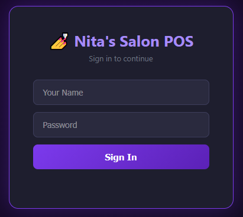

# Nita's Salon POS

A lightweight, modern, and responsive **Point of Sale (POS) and business management web application** tailored specifically for salons and beauty parlors. Designed with a clean frontend interface and robust seed data, it streamlines daily sales, service tracking, and receipt management.

---

## Login Page Preview



---

## Features

* **Interactive POS Interface**: Clean, user-friendly checkout layout optimized for fast transactions.
* **Service & Product Management**: Easily navigate and select salon treatments, packages, and products.
* **Transaction Tracking**: Built-in seed data and tracking mechanisms to review recent sales and activity.
* **Responsive Design**: Fully mobile-friendly and adaptable layout built with modern styling and UI logic.

---

## Tech Stack

* **HTML5**: Core page structure and layout.
* **CSS3 / Styling**: Modern UI elements, custom styling, and layout controls.
* **JavaScript**: Frontend logic, interactive components, and seed transaction handling.

---

## Getting Started

### Prerequisites
To run or modify this project locally, all you need is a modern web browser (Chrome, Firefox, Safari, Edge) and a code editor like [VS Code](https://code.visualstudio.com/).

### Installation & Running Locally

1. **Clone the repository**:
   ```bash
   git clone [https://github.com/HellenWamuciiNjue/nita-salon-pos.git](https://github.com/HellenWamuciiNjue/nita-salon-pos.git)

```

2. **Navigate to the project folder**:
```bash
cd nita-salon-pos

```


3. **Open the project**:
* Open the `index.html` file directly in your web browser, or use a live server extension (such as Live Server in VS Code) for the best development experience.


---

## Deployment

This project is configured for continuous deployment via **Netlify**. Any updates pushed to the `main` branch of the GitHub repository automatically trigger a live production build.

---

## Author

* **Hellen Wamucii Njue**


```

```
